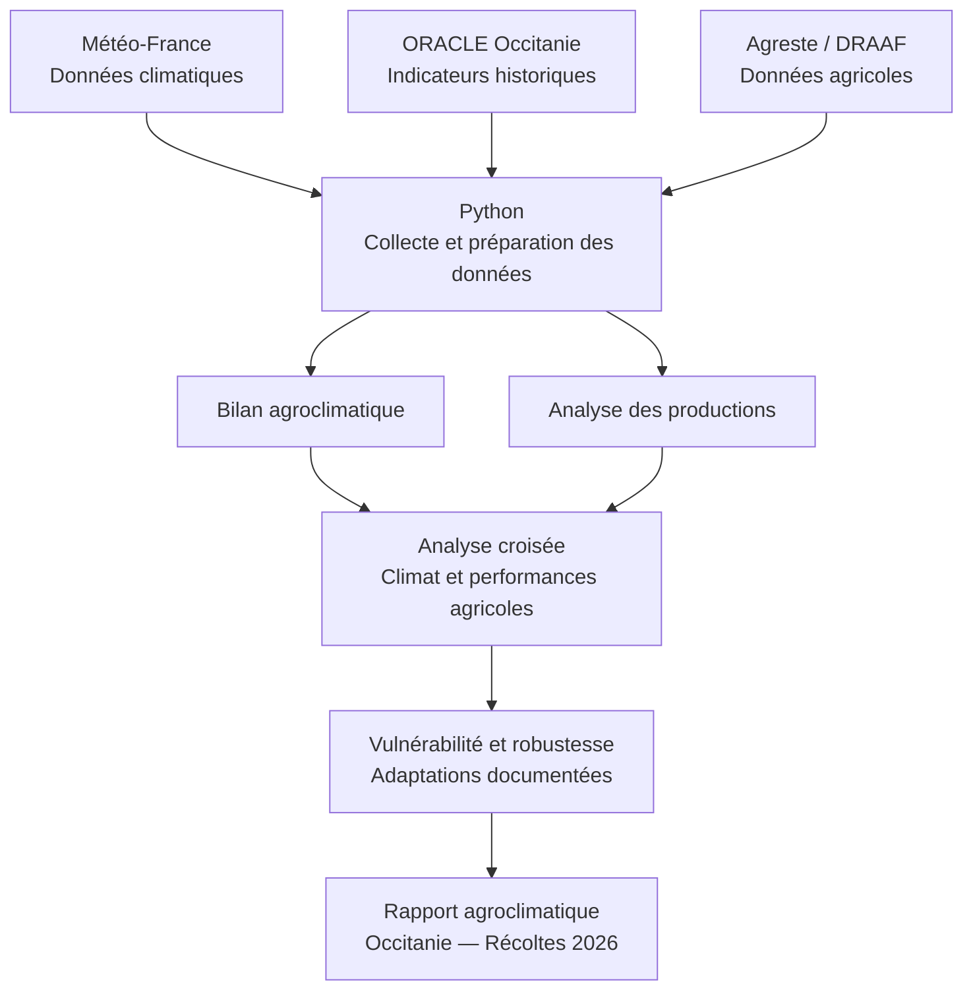

# 🌱 AgroClimate Analytics — Occitanie

### Bilan agroclimatique multi-filières des récoltes 2026

**Projet personnel Python | Master DigitalAgri 2026–2027**

> **Problématique :** Comment les conditions agroclimatiques de la campagne 2025–2026 ont-elles évolué par rapport aux références historiques, et quelles relations peut-on observer avec les performances des principales filières agricoles d'Occitanie ?

## 🎯 Objectif

Élaborer un bilan agroclimatique multi-filières des récoltes 2026 en Occitanie à partir de données ouvertes, en mobilisant Python pour :

- Analyser les conditions climatiques de la campagne 2025–2026.
- Comparer les indicateurs agroclimatiques aux références historiques.
- Étudier les relations entre climat et performances agricoles.
- Identifier les vulnérabilités potentielles et les leviers d'adaptation documentés.
- Produire un rapport agroclimatique reproductible.

## 📍 Périmètre

| Élément | Description |
|---|---|
| Territoire | Occitanie, France |
| Campagne | 2025–2026 (récoltes 2026) |
| Référence historique | 2000–2025, selon les données disponibles |
| Filières | Grandes cultures, viticulture, systèmes fourragers |
| Environnement | Python, Anaconda, Spyder |

Les périodes climatiques étudiées seront adaptées aux cycles culturaux de chaque production.

## 🔄 Méthodologie



## 🌾 Filières étudiées

| Filière | Productions envisagées |
|---|---|
| Grandes cultures | Blé dur, maïs grain, tournesol |
| Viticulture | Vigne |
| Systèmes fourragers | Prairies et production d'herbe |

*La sélection définitive dépendra de la disponibilité et de la qualité des données.*

## 📊 Sources de données

| Source | Données | Accès |
|---|---|---|
| ORACLE Occitanie | Indicateurs agroclimatiques historiques | [ORACLE](https://www.oracle-crao.fr/) |
| Météo-France | Températures, précipitations et observations quotidiennes | [data.gouv.fr](https://www.data.gouv.fr/datasets/donnees-climatologiques-de-base-quotidiennes) |
| Agreste | Surfaces, productions et rendements | [Agreste](https://agreste.agriculture.gouv.fr/) |
| DRAAF Occitanie | Conjoncture et statistiques régionales | [DRAAF](https://draaf.occitanie.agriculture.gouv.fr/) |

## 🐍 Compétences Python à développer

| Module | Bibliothèques | Objectif |
|---|---|---|
| 01 — Data Processing | pandas, NumPy | Collecte, nettoyage et traitement des données |
| 02 — Data Visualization | Matplotlib, Seaborn | Graphiques et séries temporelles |
| 03 — Statistical Analysis | SciPy, statsmodels | Tendances, corrélations et régressions |
| 04 — Geospatial Analysis | GeoPandas | Cartographie des indicateurs |
| 05 — Reporting | Python | Automatisation du rapport final |

## 📁 Organisation du projet (prévisionnelle)

```text
AgroClimate-Analytics/
│
├── README.md
├── data/
│   ├── raw/
│   └── processed/
│
├── scripts/
│   ├── 01_data_collection.py
│   ├── 02_climate_analysis.py
│   ├── 03_agricultural_analysis.py
│   ├── 04_statistical_analysis.py
│   └── 05_mapping.py
│
├── outputs/
│   ├── figures/
│   ├── maps/
│   └── reports/
│
└── requirements.txt
```

## 📦 Livrables attendus

- Base de données climatiques et agricoles structurée.
- Indicateurs agroclimatiques de la campagne 2025–2026.
- Analyses statistiques et graphiques comparatifs.
- Cartographies des contrastes territoriaux.
- Rapport agroclimatique multi-filières des récoltes 2026.
- Scripts Python documentés et reproductibles.

## ⚠️ Limites méthodologiques

Les relations statistiques entre climat et rendements ne démontrent pas, à elles seules, une causalité. Les pratiques agricoles, les sols, l'irrigation et les facteurs économiques peuvent également influencer les performances.

Les données définitives des récoltes 2026 pouvant être publiées progressivement, les résultats seront actualisés selon leur disponibilité.

## 🚀 Avancement

- [x] Définition du projet et de sa problématique
- [x] Choix du territoire : Occitanie
- [x] Identification des principales sources de données
- [ ] Vérification et téléchargement des jeux de données
- [ ] Définition des indicateurs agroclimatiques
- [ ] Développement des modules Python
- [ ] Analyse et interprétation des résultats
- [ ] Production du rapport final

---

**Auteur :** Naïm HAMIDI  
*Ingénieur agronome, EI Purpan — Master DigitalAgri, Universidad de Córdoba*

**Finalité :** développer des compétences en Python, Data Analytics et agriculture numérique à travers une étude agronomique fondée sur des données réelles.
